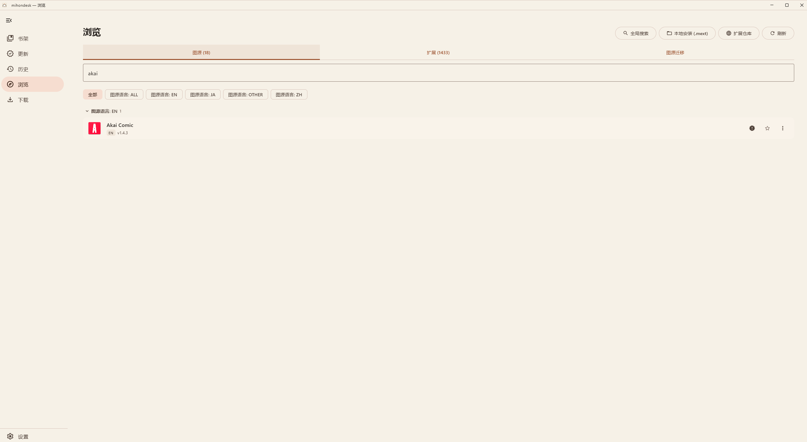
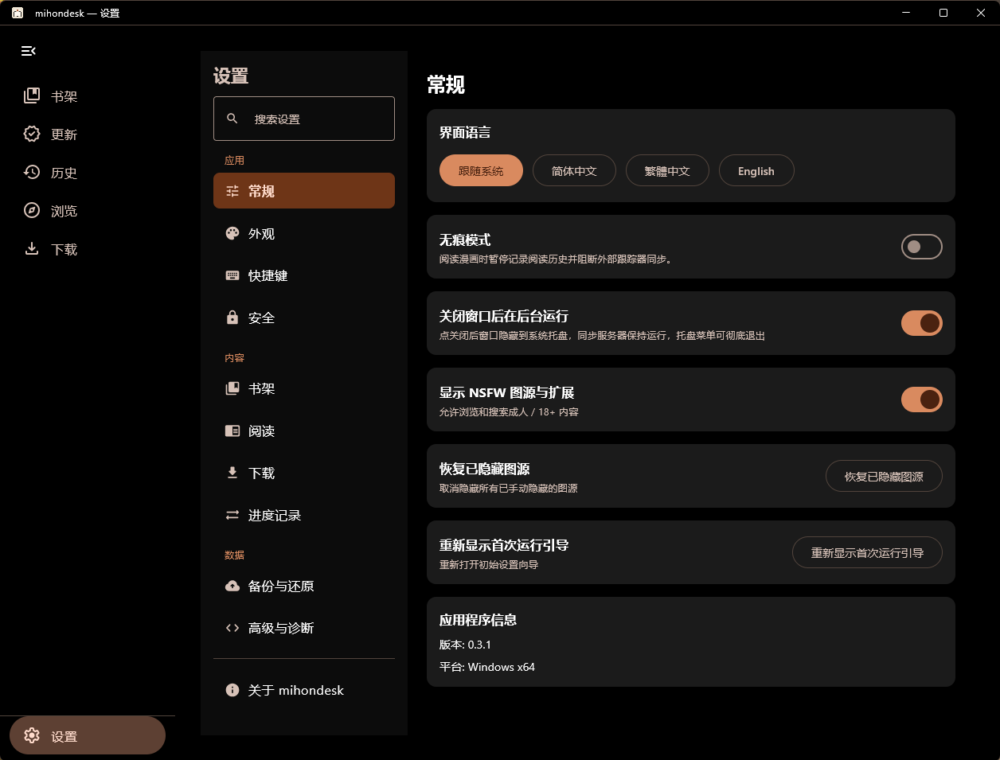

# mihondesk

**从书架到每一页，在 Windows 上阅读漫画。**

AI 辅助开发的开源项目 · 基于 Mihon · Kotlin / Compose Desktop

**[下载 Windows 版](https://github.com/1873412297-art/mihondesk/releases/latest)** · [更新日志](CHANGELOG.md) · [使用说明](docs/WINDOWS_RELEASE.md) · [反馈问题](https://github.com/1873412297-art/mihondesk/issues/new/choose)

**AI 项目说明**：本仓库的 Windows 移植、功能迭代、问题修复和文档维护使用 AI 编程助手协助完成。上游 Mihon、Suwayomi 及其他第三方项目的贡献与许可归属见文末。

## 下载与安装

当前版本：**0.3.7**。面向 **Windows 10 22H2 / Windows 11，x64**，发行包已内置 JetBrains Runtime 21（JBR），无需另装 Java。

程序、安装包和快捷方式现已统一命名为 **mihondesk**。安装版继续使用原有数据目录，支持从 MihonW 升级。

| 下载 | 适用方式 |
| --- | --- |
| **[EXE 安装包](https://github.com/1873412297-art/mihondesk/releases/download/v0.3.7/mihondesk-0.3.7.exe)** | 推荐使用，下载后按向导安装 |
| [MSI 安装包](https://github.com/1873412297-art/mihondesk/releases/download/v0.3.7/mihondesk-0.3.7.msi) | 需要 MSI 安装方式时使用 |
| [便携 ZIP](https://github.com/1873412297-art/mihondesk/releases/download/v0.3.7/mihondesk-0.3.7-windows-x64-portable.zip) | 完整解压到可写目录，运行其中的 `mihondesk.exe` |
| [SHA-256 校验文件](https://github.com/1873412297-art/mihondesk/releases/download/v0.3.7/SHA256SUMS.txt) | 校验下载文件的完整性 |

**首次使用**：发行包不预装在线图源或扩展仓库，请自行添加仓库或安装扩展。本地文件阅读无需安装图源。升级会保留已有书架、设置和阅读数据。

安装版默认将数据保存在 `%APPDATA%\MihonW`；便携版保存在 `mihondesk.exe` 同目录下的 `data` 文件夹。迁移便携版时请一并保留该文件夹。

## 界面预览

| 浏览：图源（扩展图标、语言分组、星标固定） | 设置：分组侧栏与即时生效选项 |
| --- | --- |
|  |  |

## 可以做什么

| 功能 | 说明 |
| --- | --- |
| 本地阅读 | 导入图片目录，以及 ZIP / CBZ、RAR / CBR、7z / CB7、TAR 和图片型 EPUB 等文件 |
| 桌面阅读器 | 单页、双页、纵向和条漫模式，阅读方向切换、缩放、键盘与鼠标操作；阅读中直达书籍详情 |
| 书架管理 | 分类、搜索、阅读进度和历史；在线漫画通过明确的加入书架操作收藏 |
| 图源浏览 | 安装扩展，浏览、搜索漫画并查看章节；卡片式图源 / 扩展列表显示真实扩展图标（安装时从 APK 解析）；支持部分 Mihon / Tachiyomi 扩展的转换与兼容运行 |
| 离线与更新 | 章节下载、下载队列恢复、从下载页直接阅读已完成内容，以及书库章节更新 |
| 备份与恢复 | 导入、导出 Mihon 兼容备份；具体字段支持范围见下方兼容说明 |
| 界面与操作 | 浅色 / 深色 / AMOLED 主题与 Ink 配色、可折叠导航栏、界面密度、可自定义键盘快捷键、简体 / 繁体中文与英文界面 |
| 手机书架同步 | 桌面端开启内置同步服务器后，手机扫码 / 局域网发现 / 配对码完成配对，收藏、已读、分类与阅读进度双向自动同步（0.2.20 起） |

## 开始使用

1. **安装或解压程序**，运行 `mihondesk.exe`。
2. **阅读本地文件**：使用本地导入入口选择漫画文件或图片目录。
3. **阅读在线内容**：在浏览页安装扩展包，再选择图源。安装入口支持 `.mext`，也可尝试转换受支持的扩展 `.apk`。
4. **保留阅读数据**：使用备份功能定期导出。备份不包含已下载的漫画图片。

## 0.3.7 更新

- **界面与品牌**：暖纸 + 赭墨（Ink）默认配色与新图标、首次运行启动页、JBR 自定义标题栏、可折叠导航栏（Ctrl+B）与界面密度、设置侧栏分组、可自定义键盘快捷键；
- **阅读器**：控件显示快捷键提示、缩放 HUD 与页码播报、延迟加载圈（命中缓存不闪烁）与单页内联重试；
- **浏览页**：图源 / 扩展改为卡片列表，固定改为星标、操作收进溢出菜单、语言分组可折叠；
- **真实扩展图标**：安装时从 APK 解析启动图标（兼容资源混淆与自适应图标），已安装扩展启动后自动补齐；图标经 jsDelivr / raw GitHub 镜像加载并记住可用镜像，弱网下也能快速显示；
- **网络**：「系统代理」模式现在读取 Windows 系统代理，代理不可达时回退直连；
- **修复**：在搜索框等文本框中按 Backspace / Esc 不再触发「后退」；
- 说明：0.3.0–0.3.6 为未发布的本地迭代版本，内容随本版一并发布（同版本号 MSI 会被 Windows Installer 拒绝覆盖）。

详见[本版发布说明](https://github.com/1873412297-art/mihondesk/releases/tag/v0.3.7)和[更新日志](CHANGELOG.md)。

## 0.2.24 更新

- **阅读器**：双页跨页拆分（关闭 / 始终 / 仅宽图）与宽图旋转适配、翻页过渡动画（无 / 淡入 / 滑动）、自定义色相·亮度·对比度滤镜、翻页闪屏与 Webtoon 偏好；
- **设置与数据**：设置内搜索、按来源清除非书库数据、存储占用明细、智能更新「非更新周期」过滤、自动下载仅未读与分类条件；
- **下载**：可选「章节保存为 CBZ」与「下载时拆分长图」（两项**默认关闭**，与 Android 默认值不同）；
- **扩展**：显示扩展来源商店；安装失败按原因分类提示（下载失败 / 签名被拒 / 商店已不再提供 / 其他）；
- **健壮性**：书库读写移出 UI 线程、章节设置后台串行化、同步服务器按令牌限流、删除下载的文件占用重试；**命令行运行不再登记系统托盘图标**（此前每次 CLI 运行都会在系统托盘留下一条永久记录，累积成多个重复图标）；
- 说明：0.2.23 未发布，本版直接以 0.2.24 编号发布（同版本号 MSI 会被 Windows Installer 拒绝覆盖）。

详见[本版发布说明](https://github.com/1873412297-art/mihondesk/releases/tag/v0.2.24)和[更新日志](CHANGELOG.md)。

更早版本的更新内容见[更新日志](CHANGELOG.md)与 [GitHub Releases](https://github.com/1873412297-art/mihondesk/releases)。

## 当前限制

mihondesk 仍在持续开发，桌面端尚未覆盖 Mihon 的全部功能。当前版本号为独立序列（`0.x`，现为 0.3.7），与上游 mihon `0.20.x` 无对应关系。以下限制基于[功能覆盖快照](docs/superpowers/evidence/suwayomi-feature-coverage.md)与原设计完成标准，会随验证进展持续收敛：

- **扩展与图源兼容性**：扩展可安装并加载，不代表该图源的浏览→详情→章节→图片全链可用。部分站点需要验证码或登录。2026-09-20 端到端矩阵实测：MangaDex / NHentai 全链通过，BiliManga 除搜索外全链通过（搜索需登录），MangaFire 被 Cloudflare 封锁（需人工过验证），MangaPlus 因地区封锁不可用（其 API 对本网络返回错误信封；兼容层 Filter.Select 缺陷当日已修复，授权地区网络下有望通过）。详见[扩展兼容矩阵](docs/suwayomi-extension-compatibility.md)。
- **Tracker 账户**：11 个服务均有实现与本地契约测试。2026-09-22 生产实测：**Bangumi** 与 **AniList** 已完成登录→搜索绑定→进度写入→重进保持→解绑全链验证；其余服务（MyAnimeList、Kitsu、Shikimori、MangaUpdates、Hikka、MangaBaka 及自托管 Komga / Kavita / Suwayomi）尚待账户或实例就绪后继续联调，新增服务的 OAuth 自动登录配置也未完成。
- **备份互通**：桌面端可导入/导出 Mihon 兼容备份。2026-09-20 已完成双向往返验证：真实 Android 编码器备份→桌面导入（字段级对照）、桌面导出→Android 解码器契约测试、桌面导出→Android 应用恢复→应用再导出→桌面再导入，六类字段无丢失；下载图片、密钥、SyncYomi uid、Suwayomi 私有设置不随备份迁移。详见[备份往返证据](docs/superpowers/evidence/2026-09-20-backup-roundtrip.md)。
- **安装与升级**：MSI / EXE / 便携三种形态已在干净 Windows 11 虚拟机上完成实测（14/14 验收格）：三种形态的干净安装、0.2.10→0.2.18 向导覆盖升级、卸载（保留数据 / 删除数据）与损坏回滚。其中 EXE 安装器的 `/S` 静默安装不受支持，请在图形向导中安装。三种发行形态均**不注册控制面板卸载项**，卸载请使用原安装包或便携目录删除。Win10 22H2 干净机矩阵因宿主为异构大小核平台、Windows 10 客户机内核无法完成初始化而未完成（Win11 正常），详见[干净机矩阵证据](docs/superpowers/evidence/2026-09-21-clean-machine-matrix.md)。
- **性能与稳定性**：六种阅读模式、万部库搜索等已可用。2026-09-20 四项 SLO 实测：冷启动 P95 1.24 s（目标 ≤5 s）、空闲内存中位 463 MiB（目标 <500 MB）、30 分钟阅读内存两次 1800 秒 soak 均有界、帧时间 P95 10.22 ms（真实阅读窗口负载，目标 ≤33 ms）。详见[性能证据](docs/superpowers/evidence/2026-09-20-performance-slo.md)。
- **故障恢复**：数据库迁移前快照、备份恢复事务回滚等已实现；安装过程中断已用断电注入方式实测——断电后重启系统与应用数据均完好，可重新安装。满盘、拔盘等其余场景尚未实测。
- **Android 回归**：本仓库保留 Android 模块用于格式兼容，但共享改动后的 Android 全量单测 + APK 构建尚未作为桌面端发版的强制回归门槛。

**旧版本升级**：0.2.4 及更早版本的内置更新检查指向旧仓库，首次升级请从[本仓库 Releases](https://github.com/1873412297-art/mihondesk/releases/latest)手动下载。

遇到图源、tracker 或备份问题请在 Issues 反馈，附上 mihondesk 版本、Windows 版本、扩展名称/版本、复现步骤和错误信息。

## 反馈与开发

遇到问题请在[本仓库 Issues](https://github.com/1873412297-art/mihondesk/issues)反馈，附上 mihondesk 版本、Windows 版本、复现步骤和错误信息。图源问题请同时提供扩展名称及版本。

欢迎提交改进，参见[贡献指南](CONTRIBUTING.md)。开发资料：

- [扩展兼容矩阵](docs/suwayomi-extension-compatibility.md)
- [功能覆盖与验证范围](docs/superpowers/evidence/suwayomi-feature-coverage.md)
- [Windows 发行与升级说明](docs/WINDOWS_RELEASE.md)
- [开发环境与构建](docs/windows-development.md)
- [图标与品牌资源](docs/BRANDING.md)

## 作者

[@1873412297-art](https://github.com/1873412297-art)

## 致谢上游

感谢 [Mihon](https://github.com/mihonapp/mihon)、[Tachiyomi](https://github.com/tachiyomiorg) 与 [Suwayomi-Server](https://github.com/Suwayomi/Suwayomi-Server) 及其贡献者。上游代码的版权归原作者所有；mihondesk 的问题请在本仓库反馈，不要提交到上游。

## 上游与许可

本项目是 [Mihon](https://github.com/mihonapp/mihon) 的独立 Windows 移植项目，基于其阅读与备份相关实现，并参考 [Suwayomi-Server](https://github.com/Suwayomi/Suwayomi-Server) 的扩展兼容与后台服务实现。Android 原版请访问 [Mihon 官网](https://mihon.app)。

项目采用 [Apache License 2.0](LICENSE)。桌面端第三方组件及许可见 [THIRD-PARTY-DESKTOP.txt](THIRD-PARTY-DESKTOP.txt)。程序本身不提供或托管漫画内容。

Copyright © 2015 Javier Tomás

Copyright © 2024 Mihon Open Source Project
