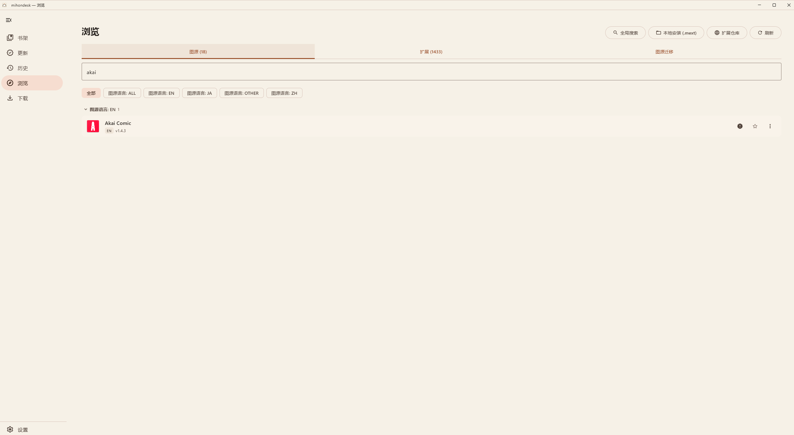
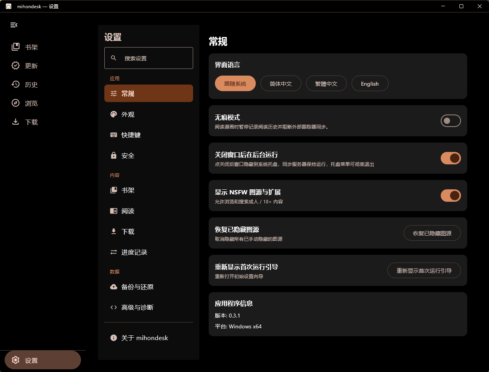

# mihondesk

**从书架到每一页，在 Windows 上阅读漫画。**

基于 Mihon 的桌面漫画阅读器 · Kotlin / Compose Desktop · AI 辅助开发

**[下载最新版](https://github.com/1873412297-art/mihondesk/releases/latest)** · [更新日志](CHANGELOG.md) · [反馈问题](https://github.com/1873412297-art/mihondesk/issues/new/choose)

## 下载

当前版本 **0.5.0**，支持 Windows 10 22H2 / Windows 11（x64），已内置 Java 运行时，无需另装。

| 下载 | 说明 |
| --- | --- |
| **[EXE 安装包](https://github.com/1873412297-art/mihondesk/releases/download/v0.5.0/mihondesk-0.5.0.exe)** | 推荐，按向导安装 |
| [MSI 安装包](https://github.com/1873412297-art/mihondesk/releases/download/v0.5.0/mihondesk-0.5.0.msi) | 需要 MSI 时使用 |
| [便携 ZIP](https://github.com/1873412297-art/mihondesk/releases/download/v0.5.0/mihondesk-0.5.0-windows-x64-portable.zip) | 解压到可写目录后运行 `mihondesk.exe` |
| [macOS DMG](https://github.com/1873412297-art/mihondesk/releases/download/v0.5.0/mihondesk-0.5.0-macos-arm64.dmg) | Apple Silicon，未签名；首次打开请在 Finder 中右键“打开” |

可用 [SHA256SUMS.txt](https://github.com/1873412297-art/mihondesk/releases/download/v0.5.0/SHA256SUMS.txt) 校验下载文件。装好后，新版本发布时应用会自动提醒。

## 界面预览

| 浏览图源 | 设置 |
| --- | --- |
|  |  |

## 功能

- **本地阅读**：图片目录，以及 ZIP / CBZ、RAR / CBR、7z / CB7、TAR 和图片型 EPUB。
- **阅读器**：单页、双页、纵向与条漫模式，键盘和鼠标操作，缩放与滤镜。
- **书架**：分类、搜索、阅读进度与历史，书架更新与章节下载。
- **在线图源**：安装扩展浏览和搜索，兼容部分 Mihon / Tachiyomi 扩展。
- **备份与同步**：导入、导出 Mihon 兼容备份；通过 Google Drive 同步书架和阅读进度，手机端见 [Android 伴侣应用](mobile-companion/README.md)。
- **界面**：浅色 / 深色 / AMOLED 主题、可自定义快捷键，简体中文、繁体中文与英文界面。

## 开始使用

1. 安装或解压后运行 `mihondesk.exe`。
2. 阅读本地漫画：使用本地导入选择文件或图片目录。
3. 阅读在线漫画：发行包不预装图源，请在浏览页添加扩展仓库或安装扩展。
4. 定期导出备份。备份不包含已下载的图片。

数据位置：安装版在 `%APPDATA%\MihonW`，便携版在程序旁的 `data` 文件夹（迁移便携版时一并带走）。升级会保留书架、设置和阅读数据。

## 当前限制

mihondesk 仍在开发中，尚未覆盖 Mihon 的全部功能，版本号（`0.x`）与上游 Mihon 无关。

- **图源**：扩展能安装不代表整条阅读链可用，需要验证码或登录的站点可能受限，见[扩展兼容矩阵](docs/suwayomi-extension-compatibility.md)。
- **Tracker**：Bangumi 与 AniList 已完成实测，其余服务仍在联调。
- **安装**：EXE 安装器不支持 `/S` 静默安装；三种形态都不注册控制面板卸载项。
- **备份**：下载的图片、密钥等不随备份迁移。

完整的验证范围与证据见[功能覆盖快照](docs/superpowers/evidence/suwayomi-feature-coverage.md)和 [Windows 发行说明](docs/WINDOWS_RELEASE.md)。

## 反馈与参与

遇到问题请在 [Issues](https://github.com/1873412297-art/mihondesk/issues) 反馈，附上 mihondesk 与 Windows 版本、复现步骤和错误信息；图源问题请附扩展名称与版本。欢迎提交改进，见[贡献指南](CONTRIBUTING.md)与[开发环境说明](docs/windows-development.md)。

## 致谢与许可

mihondesk 是 [Mihon](https://github.com/mihonapp/mihon) 的独立桌面移植，参考了 [Suwayomi-Server](https://github.com/Suwayomi/Suwayomi-Server) 的扩展兼容实现，感谢 Mihon、[Tachiyomi](https://github.com/tachiyomiorg) 与 Suwayomi 的贡献者。本项目的问题请在本仓库反馈，不要提交到上游。项目的移植、迭代与文档由作者 [@1873412297-art](https://github.com/1873412297-art) 借助 AI 编程助手完成。

采用 [Apache License 2.0](LICENSE)，第三方组件许可见 [THIRD-PARTY-DESKTOP.txt](THIRD-PARTY-DESKTOP.txt)。程序本身不提供或托管漫画内容。

Copyright © 2015 Javier Tomás · Copyright © 2024 Mihon Open Source Project
