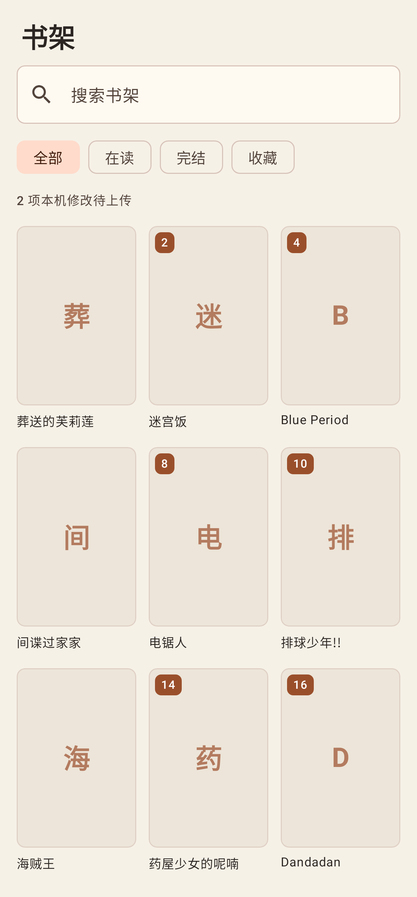
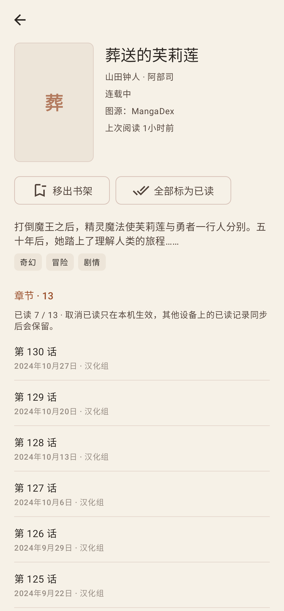
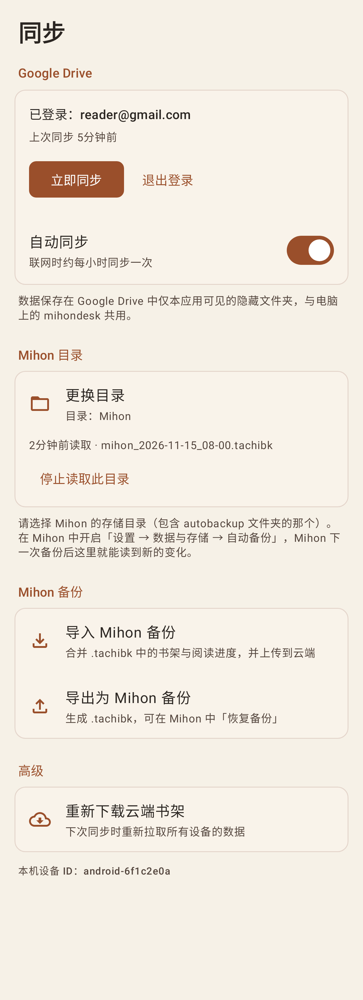

# mihondesk 伴侣（Android）

在手机上查看、整理 mihondesk 的书架，并通过 **Google Drive** 与电脑同步。
选好 **Mihon 的数据目录** 后，每次打开应用都会自动读取 Mihon 最新的自动备份，合并后上传到 Google Drive，
电脑上的 mihondesk 下次同步就能看到手机 Mihon 里的书架和阅读进度。

| 书架 | 详情 | 同步 |
| --- | --- | --- |
|  |  |  |

配色与桌面端默认主题「墨韵纸色」一致，跟随系统深色模式。

## 能做什么

- **书架**：按分类筛选、搜索，封面角标显示未读数。
- **详情**：简介、标签、章节列表；点章节切换已读，一键全部标为已读，移出 / 加入书架。
- **最近**：所有同步设备上的阅读记录，按时间排序。
- **同步**：用手机上的 Google 账号授权（不需要输入密码），手动同步或联网时约每小时自动同步；本机修改后约 30 秒自动上传。
- **Mihon 目录**：选一次 Mihon 的存储目录，之后每次打开应用（以及后台每小时同步时）自动读取最新的自动备份并上传。
- **Mihon 备份（手动）**：导入 `.tachibk` 会合并书架、分类、已读和历史，并上传到云端；导出的 `.tachibk` 可在 Mihon 中「恢复备份」。

本应用不包含阅读器和图源扩展，阅读仍在 Mihon 或 mihondesk 中进行。

## 自动读取 Mihon

Android 不允许其他应用读取 Mihon 的数据库，能读到的是 Mihon 写在存储目录里的**自动备份**。设置方法：

1. 在 Mihon 中打开「设置 → 数据与存储」，确认存储位置（默认是内部存储的 `Mihon` 文件夹），并开启**自动备份**（频率越高，手机这边越新）。
2. 在本应用「同步」页点「选择 Mihon 数据目录」，选中 Mihon 的存储目录（包含 `autobackup` 的那个），也可以直接选 `autobackup`。
3. 之后每次打开应用、点「立即同步」或后台每小时同步时，都会读取最新的 `.tachibk`。同一个备份只读一次，Mihon 写出新备份后才会再读。

说明：

- 手机这边看到的是 Mihon **上一次备份时**的状态。想马上同步，可以在 Mihon 里手动「创建备份」到同一目录，再打开本应用。
- 方向是 Mihon → 本应用 → Google Drive。电脑上的改动会同步到本应用，但不会自动写回 Mihon；需要时用「导出为 Mihon 备份」再在 Mihon 中恢复。
- 在 Mihon 里移出书架的漫画不会从同步数据里删除（备份里只有书架上的漫画，看不出「删除」）。

## 工作方式

- 与桌面端共用仓库里的 `sync` 模块：同一个 `SyncEngine`、同一套合并规则（`SyncMergePolicy`）、同一个 Drive 传输层（`GoogleDriveTransport`）。手机就是另一个同步设备，有自己的设备 ID，在 Drive 隐藏的 `appDataFolder` 中写自己的 `mihon-sync-<设备ID>.pb`。
- 只申请 `drive.appdata` 权限：应用只能看到自己的隐藏文件夹，看不到你 Drive 里的其他文件。
- 手机书架保存在应用私有目录的 `library/library.pb`。本机修改按序号记为「待上传」，推送成功后才清除，所以导入的旧 Mihon 备份（时间戳很早）也一定会上传。
- Mihon 备份里的修改时间是秒，同步协议用毫秒，导入 / 导出时自动换算。

### 已知限制（与桌面端一致）

- 已读和书签按「任一设备已读即已读」合并。在手机上取消已读只在本机生效，同步后会被其他设备的已读记录恢复。
- 本地图源（source id 0）的漫画不参与同步。
- 不同步删除：移出书架会同步，但条目本身保留。

## 配置 Google 登录（必须）

Drive 的 `appDataFolder` 按 **Google Cloud 项目** 隔离。手机必须使用与桌面端 OAuth 客户端
（`GoogleDriveConfig.DEFAULT_CLIENT_ID`）**同一个 Cloud 项目** 中的 Android OAuth 客户端，否则会看到一个空文件夹。

1. 打开该项目的 Google Cloud Console → API 和服务 → 凭据 → 创建凭据 → OAuth 客户端 ID → **Android**。
2. 软件包名称填 `app.mihondesk.companion`（或构建时用 `-Pcompanion.applicationId=...` 指定的值）。
3. 填入签名证书的 SHA-1。调试版：

   ```bash
   keytool -list -v -keystore ~/.android/debug.keystore -alias androiddebugkey -storepass android
   ```

   正式版填发布密钥的 SHA-1；通过 Google Play 分发时填 Play 应用签名密钥的 SHA-1。
4. OAuth 同意屏幕已包含 `.../auth/drive.appdata` 范围；若应用仍处于「测试」状态，把要登录的账号加为测试用户。

代码里不需要写客户端 ID：Google Play 服务按包名 + 签名匹配 Android 客户端。

## 构建

这是独立的 Gradle 工程，不参与桌面端构建。需要 Android SDK（compileSdk 37）和 JDK 17、21。

```bash
./gradlew -p mobile-companion assembleDebug
```

```bash
./gradlew -p mobile-companion spotlessApply :app:testDebugUnitTest
```

产物：`mobile-companion/app/build/outputs/apk/debug/app-debug.apk`。
SDK 路径写在 `mobile-companion/local.properties`（`sdk.dir=...`）或环境变量 `ANDROID_HOME`。

## 代码结构

```
app/src/main/kotlin/mihon/companion/
  CompanionRuntime.kt      组装根：存储、Google 授权、Drive 传输
  data/                    书架存储、合并、本机编辑、Mihon 备份编解码、同步状态
  sync/                    Google 授权、令牌、同步服务、WorkManager 后台任务
  ui/                      Compose 界面：每个页面一个 Presenter（不可变 UiState + StateFlow）
```

遵守仓库 `CLAUDE.md` 的约束：单文件不超过 400 行、单函数不超过 60 行，业务状态放在 Presenter，不吞异常。
